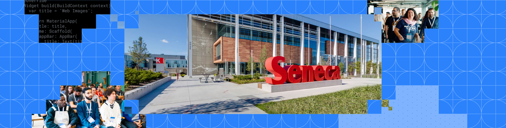

# GDG on Campus @ Seneca Polytechnic

A student-run Google Developer Group at Seneca Polytechnic in Toronto. We learn Google technologies by building real things with them: websites, cloud apps, AI with Gemini, and mobile apps, through info sessions, workshops, code jams, hackathons, and Cloud Study Jams.

Events are free and open to any Seneca student.

- **Events and RSVPs:** [gdg.community.dev](https://gdg.community.dev/gdg-on-campus-seneca-polytechnic-toronto-canada/)
- **All our links:** [linktr.ee/senecagdg](https://linktr.ee/senecagdg)
- **Chapter info, event plans, and slides:** [GDG-on-Campus-Seneca-Polytechnic/info](https://github.com/GDG-on-Campus-Seneca-Polytechnic/info)
- **Want to run a session or pitch an idea?** [Open an issue](https://github.com/GDG-on-Campus-Seneca-Polytechnic/info/issues/new/choose)
